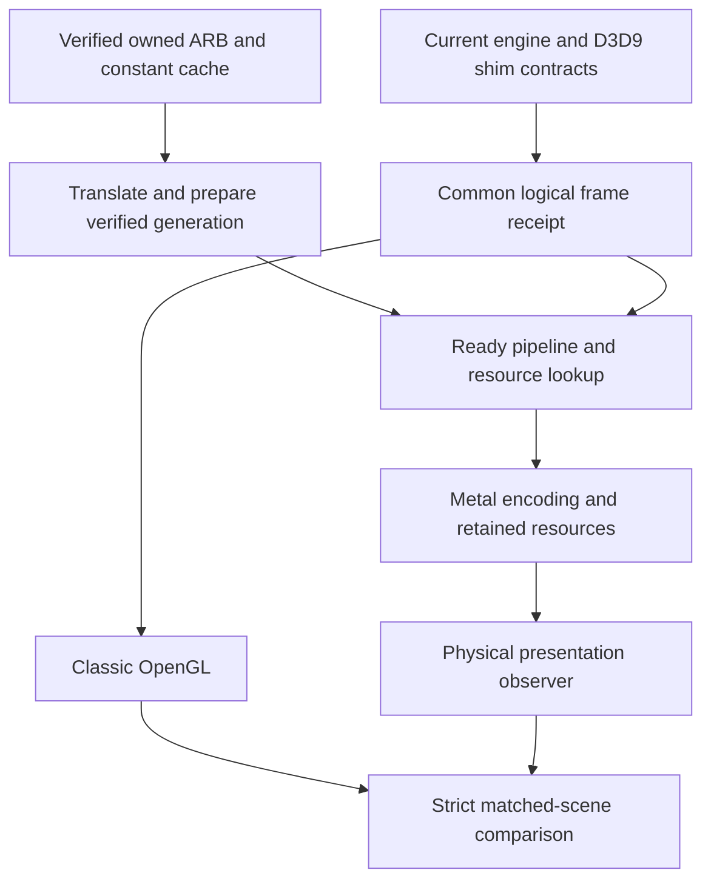
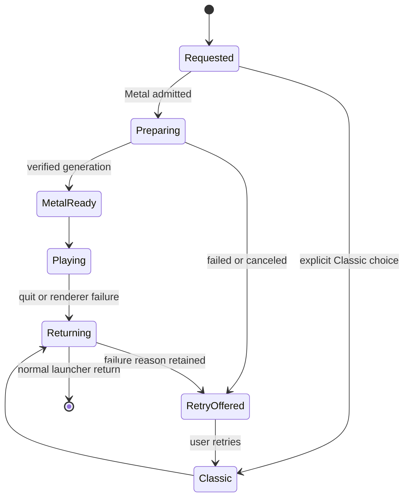

# CoD2 Silicon 0.3 Metal Readiness - Plan

## Goal Capsule

- Objective: players can choose a native Metal renderer that preserves CoD2's appearance and gameplay, with measured frame pacing and a reliable return to Classic OpenGL when needed.
- Means: reconcile the existing renderer donor with the current engine, then close its certification gaps (KTD1–KTD6).
- Authority: the user's macOS 26+ requirement and research/preparation scope govern this document; `CONTRIBUTING.md` governs implementation and merge evidence. `docs/ROADMAP.md` defines the broader 0.3 direction.
- Execution profile: this preparation creates no renderer code or release. U1 is the first bounded implementation task when implementation is authorized; later units depend on its recovered source and integration map.
- Stop conditions: stop promotion when a contract regresses, required private evidence is unavailable, a readiness check fails, or a result cannot be tied to the tested source and package.
- Ownership: the implementation owner integrates and verifies the units; the release owner decides default promotion and publication from the resulting evidence. Preparing this plan does not authorize publishing 0.3.

---

## Product Contract

### Summary

Bring the existing native Metal implementation onto the current engine in reviewable slices. Keep the classic path usable while proving shader semantics, equivalent submitted work, visible combat and physical presentation. Modern rendering options follow faithful classic Metal as separate decisions within the wider 0.3 phase.

### Problem Frame

The release branch has a verified macOS 26 deployment floor but no native Metal backend. A dormant Metal branch contains substantial code and favorable pixel diagnostics, yet its own certification report says it is not ready to become the default. Since that branch diverged, current engine work repaired water, map lighting, saved-screen copies, FX and lifecycle behavior. Reusing its old acceptance results would obscure those changed inputs.

### Key Decisions

- Research and preparation precede implementation. (session-settled: user-directed — chosen over implementing additional improvements now: the user selected deeper research and preparation.) Governs R1.
- Faithful Metal precedes optional visual features. This sequencing follows the existing native-renderer contract and keeps the first acceptance claim testable. Governs R4, R8.

### Requirements

**Scope and compatibility**

- R1. This preparation produces a source-grounded plan and study without implementing or publishing renderer changes.
- R2. Both Metal and Classic OpenGL support macOS 26 and later; device admission must check the capabilities actually used.
- R3. Preserve stock and CoD2x gameplay, network, GSC, demo and server-policy behavior across renderer selection.
- R4. Classic OpenGL remains the default until the Metal promotion gates in the Verification Contract pass, and remains explicitly selectable afterward.

**Content and correctness**

- R5. Translate only the player's verified owned shader cache locally, keeping game content and derived shader/cache payloads out of the repository and release bundle.
- R6. A successful Metal readiness result distinguishes translated programs, prepared pipelines, admitted draws, visible effects and physical presentation.
- R7. Failed or canceled preparation preserves the owned input and last verified cache; a live renderer failure must not cause a hidden in-place switch or indefinite missing geometry.

**Release evidence**

- R8. Certify faithful classic rendering before adding MetalFX, render scaling, supersampling, HDR/EDR, refresh enhancements or Game Mode optimization.
- R9. Bind each acceptance claim to source, artifact, hardware, OS, shader identity and resolved scene, with unavailable or diagnostic-only evidence labeled accurately.

### Acceptance Examples

- AE1. Covers R4, R7. Given a requested Metal launch with an unusable cache, preparation fails without replacing the last verified cache; the launcher offers an explained Classic OpenGL retry before a new game process starts.
- AE2. Covers R6, R9. Given near-identical GL and Metal screenshots without matching logical-input receipts, the result remains diagnostic and cannot promote Metal.
- AE3. Covers R3, R7. Given a ready-pipeline miss during a live match, the backend records a typed failure and terminates the affected session through the existing owned-process lifecycle; the launcher offers a Classic retry to the game menu without changing the saved renderer preference. The player chooses whether to reconnect.
- AE4. Covers R4, R9. Given passing synthetic GPU tests but no supported macOS 26 gameplay evidence, Metal remains opt-in and the missing gate remains visible.

### Scope Boundaries

The active units cover recovery, integration and certification of the existing native renderer. They do not replace CoD2 with a Bevy runtime, introduce Wine into the native application, change original network/GSC contracts, or redistribute shaders. A generalized compatibility database service is not needed: local structured run receipts suffice unless support evidence later justifies a shared service. A new generic rendering abstraction is not needed while the existing shim contracts remain viable.

### Deferred to Follow-Up Work

MetalFX/render scale, supersampling, anisotropic-option expansion, EDR/HDR, ProMotion/VRR refinement, widescreen FOV/HUD improvements and Game Mode measurement remain `docs/ROADMAP.md` directions. Existing donor extension points are not proof these options ship. Each needs its own bounded plan after R8, including server-policy and classic-mode checks. iPad/Apple TV, voice capture, cinematics, placeholder-global audits and server management remain separate tracks.

---

## Planning Contract

### Starting Evidence

The integrated base is `7e1851faeee45d45ed8dbf0ded2d8ec813b8e577`. The immutable renderer donor is `bf71e8ecd9985a57c69f27edf442516a8dd02074`, formerly `port/metal-cert`; ancestor is `3ef770ba088808f87805ba748839db2ca53e9dad`. Preserve/recover those objects from the verified cleanup archive if the local refs have been removed. Donor file paths below are restoration candidates and do not exist on the integrated base until selected for integration.

The donor's WS29–WS35, WS37 and WS39 reports map core, resources, state, shader, draw, target and certification work. WS39 retains three promotion blockers: presentation freshness, complete logical-input/factory receipts and visible dense FX/combat. Its historical 417-program translation result does not cover current source or all-program semantic parity. The [research study](../research/2026-10-13-iw4l-highball.md) records source pins, upstream lessons and limitations.

### Key Technical Decisions

- KTD1. **Use the donor as audited source slices, not a whole-branch merge.** Its existing D3D9 object contracts, sidecars and ARB-to-MSL compiler match the product direction. Reconcile 38 shared changed paths and semantic dependencies against current code. Preserve current water, lighting, saved-screen, FX, launcher and macOS 26 changes; recognize already-integrated gameplay repairs rather than replaying them. Governs implementation of R2, R3.
- KTD2. **Retain the existing parser/register-IR/MSL path and explicit refusal rules.** IW4L's typed shader admission informs coverage and diagnostics, not a new SM3/WGSL dependency. The donor already has this boundary. Treat its 17 Apple-GL-rejected original programs as an oracle gap requiring independent evidence, not a reason to weaken acceptance. Governs R5, R6.
- KTD3. **Keep compilation in preparation and loading windows.** Cache identity covers owned source/metadata digests, translator/compiler version and relevant GPU/OS identity. Publish a completed verified generation atomically, preserve the prior one on failure, and reject incompatible archives. Ready draws never compile synchronously. A live miss follows AE3; no renderer hot-swap is introduced. IW4L's queued/ready pipeline and world-generation boundaries support this separation. Governs R6, R7.
- KTD4. **Make a common logical receipt precede backend encoding.** Record stable logical draw/pass/resource identities, effective state, scene clock, camera and factory counters at the same capture boundary for both renderers. Backend-specific GPU handles are not equality keys. Extend the donor's strict comparator instead of promoting its `certified=false` replay mode. IW4L's resolved scene recordings inform replay identity. Governs R6, R9.
- KTD5. **Measure physical presentation separately from simulation and GPU completion.** Retain whole-frame backpressure admission and completion-owned resource retirement. Match source, bundled SDL, frame cap, resolution and observer configuration in paired runs. Highball's environment-bound outcomes inform the receipt fields; average FPS and CPU enqueue time cannot prove freshness. Governs R6, R9.
- KTD6. **Use a capability-tested opt-in rollout before default promotion.** Selection is latched at renderer initialization, with requested/effective backend and refusal reason recorded. Preserve explicit Classic choice. Current launcher lifecycle owns retry and cleanup. Apple's [Metal capability tables](https://developer.apple.com/metal/capabilities/) inform admission; OS version alone is not the test. Governs R2, R4, R7.

No architectural bake-off is needed: the selected native shim route has a substantial implementation, and changing runtime or graphics API would change the product contracts. Narrow implementation variants can be decided within these boundaries after U1.

### Assumptions and Deferred Measurements

The plan assumes access to the preserved donor commit and the owner's licensed shader/data inputs during implementation. U1 verifies recovery before dependent units start. Initial integration may use current local hardware; default promotion additionally needs evidence from macOS 26 and a later supported OS. There is no performance claim for untested Macs.

Pixel thresholds inherit the donor classic contract through G4. The physical display targets in G5 use a controlled 60 Hz reference mode; other refresh rates need declared rate-relative thresholds before their measurements. Actual performance improvement, complete shader oracle coverage and current dedicated-target linkage are execution-time results, not assumptions of success.

### High-Level Technical Design

Selection/refusal combinations are owned by KTD6: Classic request never triggers Metal preparation; supported Metal with verified preparation enters Metal; unsupported or failed Metal reports the reason and offers Classic; a runtime fault returns through the existing lifecycle rather than switching the active engine.

### Sequencing and System Impact

U1 → U2 → U3 → U4 creates an opt-in integrated candidate. U5 and U6 then produce correctness and presentation evidence; U7 consumes both. U2–U4 are integration batches, each split into atomic donor provider/seam changes during execution; no batch may replace current common-engine files wholesale.

Renderer changes cross shim callbacks, private object ownership, native window/display handling, shader-cache persistence and launcher process handoff. Both stock and CoD2x clients, plus the headless dedicated build boundary, therefore remain in verification scope. Diagnostics must not expose CD keys or copy licensed payloads into public CI artifacts.

---

## Implementation Units

### U1. Recover the donor and establish the integration map

- Goal: make the exact prior implementation and its unresolved evidence available without reviving stale release claims.
- Requirements: R3, R9. Dependencies: merged preparation baseline and verified recovery archive.
- Files: restore historical `docs/macos-port/reports/WS29-metal-core.md`, `WS30-metal-resources.md`, `WS31-metal-states.md`, `WS32.md`, `WS33-metal-draws.md`, `WS34.md`, `WS35-metal-parity.md`, `WS37-metal-finish.md`, `WS39-metal-cert.md`; add `docs/macos-port/metal-integration-03.md`.
- Approach: classify donor-only providers, changed shared seams, duplicated common repairs and private evidence dependencies under KTD1. Resolve modern deployment settings and current `CONTRIBUTING.md` requirements before carrying scripts forward. Record source identities and per-slice expected tests in the integration map.
- Patterns: donor `docs/macos-port/metal-interfaces.md`; current WS75 and WS94 fidelity reports.
- Test expectation: none — this unit changes only recovery documentation and integration mapping. Verify object recovery, path inventory and public/private boundaries by inspection.
- Verification: every proposed integration slice points to recoverable source and the current owning tests; historical failures remain explicit.

### U2. Reconcile native dispatch, resources and presentation ownership

- Goal: restore opt-in Metal object/submission support behind the existing engine contracts.
- Requirements: R2–R4. Dependencies: U1.
- Files: donor `src/Mac/Metal/metal_{abi.h,backend.h,backend.m,core.h,core.m,dispatch.m,gpu.m,frame.m,resources.h,resources.m}`, `shim_dispatch.h`, `resource_formats.{h,m}`; current `src/Mac/DirectX_9/` dispatch seams, `src/platform/macos_display.c`, restored `src/platform/macos_metal_present.{h,m}`, `CMakeLists.txt`; donor `tests/metal/{core.c,resources.m,resource_formats.c}`, `tests/platform/metal_present.m`, current `tests/platform/CMakeLists.txt`.
- Approach: retain ABI-1 sidecars and typed parameter addresses under KTD1. Reconcile current native object sizes, surface identity and fullscreen/focus handling. Keep resource lifetime tied to GPU completion, independent of COM release. Bring the donor's synthetic core/resources runners with each provider.
- Execution note: characterize the current GL dispatch and native-OFF views before inserting hooks.
- Test scenarios:
  1. Unsupported capability or failed device creation produces an explained pre-scene refusal without changing the Classic default.
  2. An object released with GPU work pending retires only after completion; reused addresses never inherit an old backend identity.
  3. DISCARD and NOOVERWRITE updates preserve in-flight data and reject out-of-bounds ranges.
  4. Resize/fullscreen/app switch with pending work preserves the current backbuffer identity and exits without deadlock.
- Verification: core/resource/transport fixtures, current platform suites and ABI checks pass for stock and CoD2x; native-OFF comparisons remain unchanged.

### U3. Reconcile shader admission, state and cache generations

- Goal: prepare verified shader pipelines before draws and make failures recoverable.
- Requirements: R5–R7. Dependencies: U2.
- Files: donor `src/Mac/Metal/{arb_to_msl.cpp,arb_to_msl.h,shader_setup.mm,shader_provider.mm,shader_archive.mm,shader_fixed.cpp,metal_states.cpp,metal_states_gpu.mm,metal_state_cache.hpp}` and their headers; `tools/metal/{translate.cpp,prepare.mm,check_invalid.py,check_semantics.py}`; donor `tests/metal/{parser.cpp,semantic.mm,provider.mm,setup.py,states.cpp,states_gpu.mm,raster.mm,fixed_contract.cpp,fixed_gpu.mm}`; current `src/platform/cod2x_native_shaders.m`, `tests/packaging/shaders.py`.
- Approach: apply KTD2–KTD3 to the existing translator and cache rather than importing a new compiler. Maintain separate translated, compiled, semantically checked and drawable coverage counts. Verify unknown operations, bounds, metadata and original undefined cases against explicit oracles.
- Patterns: existing extractor lock/staging and donor canonical pipeline-key cache.
- Test scenarios:
  1. Synthetic swizzle, masks, saturation, relative addressing, constants and texture dimensionality agree with declared arithmetic/raster oracles.
  2. Unsupported operation or malformed constant metadata refuses with stage/source identity and publishes no partial generation.
  3. Cancellation, compiler failure and incompatible OS/GPU archive preserve the last verified generation and offer a clean retry.
  4. A changed shader, declaration or render state cannot reuse an incompatible pipeline; a ready lookup produces zero compiler/factory work.
- Verification: synthetic translator/provider/state fixtures pass; the private owned corpus receives per-program results without treating GL-rejected cases as equivalence passes.

### U4. Reconcile targets, draws and loading admission

- Goal: restore complete opted-in Metal scenes while retaining the current engine's corrected inputs.
- Requirements: R3, R6, R7. Dependencies: U3.
- Files: donor `src/Mac/Metal/{metal_targets.m,metal_target_shim.m,draw_contract.cpp,metal_draws.mm,metal_materials.m,metal_integration.mm}` and associated headers; current `src/PC/gfx_d3d/{r_init.c,rb_backend.c,rb_shade.c,rb_state.c,rb_tess.c}`, `src/Mac/DirectX_9/CDirect3DDevice.c`; donor `tests/metal/{targets.m,target_shim.m,draw_contract.cpp,draws_gpu.mm,map_lifetime.c,tess_overflow.c}`; current `tests/lp64/renderer/{saved_screen.c,water.c,viewport_constants.c}`.
- Approach: enroll required materials during UI/map loading under KTD3. Preserve current water coordinates, authored lighting and saved-screen copies. Keep target copies, color order, mip completeness, volume uploads and screenshot orientation explicit. Route a live readiness failure through AE3.
- Test scenarios:
  1. Indexed/UP draws reject invalid bounds without encoding a partial frame.
  2. Target alias copies, partial clears and saved-screen restore match current contracts without unwanted Y flip or color conversion.
  3. A map restart with reused resources does not bind a prior world's generation.
  4. A synthetic missing pipeline reaches the typed failure and launcher-return path without compiling during play.
- Verification: donor draw/target/lifetime runners and current renderer regressions pass; opted-in menu→map→quit works on one exact packaged candidate before certification begins.

### U5. Close strict parity and visible coverage gaps

- Goal: replace diagnostic pixel similarity with evidence that the same scene and work were rendered.
- Requirements: R3, R6, R9. Dependencies: U4.
- Files: donor `tests/metal/{goldens.py,test_goldens.py,observed_states.py}`, `docs/macos-port/metal-goldens.md`; current `src/PC/gfx_d3d/{rb_backend.c,rb_shade.c,r_screenshot.c}`, restored `src/Mac/Metal/metal_draws.mm`; proposed `tests/metal/test_frame_receipts.py` and common private receipt header `src/Mac/DirectX_9/lp64_frame_receipt.h`.
- Approach: implement KTD4 at the smallest common pre-encoding boundary. Re-record current six-map scenes plus water, authored lighting, saved-screen, interiors, HUD/scoreboard, animated/skinned players and visible combat. Use original Mac/Windows reference evidence where GL itself lacks the intended behavior, notably incomplete stencil/copy variants and undefined shader cases.
- Test scenarios:
  1. Comparator rejects missing, stale, unequal or backend-specific logical identities even when images match.
  2. Comparator rejects unrepeatable GL input before judging Metal pixels.
  3. A scene labeled smoke/explosion must include actual creation receipts and visible target-frame content; empty-scene similarity fails coverage.
  4. Stock and CoD2x corpora use their own exact binary and matching resolved inputs; a mixed-build comparison fails.
- Verification: G4 passes or enumerates an unclosed case; no diagnostic mode is relabeled certified.

### U6. Close presentation and lifecycle gaps

- Goal: prove that complete fresh frames reach the display without resource leaks or launcher regressions.
- Requirements: R4, R6, R7, R9. Dependencies: U4; use U5 scenes for matched measurement.
- Files: donor `src/platform/macos_metal_present.m`, `src/Mac/Metal/{metal_frame.m,metal_gpu.m,metal_frame_stats.h}`, `tools/metal/leak_gate.py`, `tools/tests/test_metal_leaks.py`, `tests/platform/metal_present.m`; current `tests/launcher/{lifecycle.py,lifecycle.m}`, `tools/macos/benchmark.py`; proposed `tests/metal/test_presentation_receipts.py`.
- Approach: follow KTD5 with physical-present callbacks and unfiltered interval ledgers. Use the same packaged dependencies throughout each paired run. Keep timing and correctness runs separate and respect the existing bench lease/unlocked-session rules.
- Test scenarios:
  1. Filled producer slots reject the whole frame until Present; later credit does not admit only its suffix.
  2. GPU/presenter completion after teardown cannot access destroyed owner state.
  3. Observer gaps or absent total/leak evidence cause a failed or unavailable result, not a pass.
  4. Fullscreen/Spaces, app switch, resize, normal quit and engine failure return one owned game session to the launcher without duplicate processes.
- Verification: G5–G6 pass at the declared conditions, or the failing scenario keeps promotion blocked.

### U7. Package the opt-in candidate and decide default promotion

- Goal: expose truthful backend readiness and ship only the capability level actually certified.
- Requirements: R2, R4, R7–R9. Dependencies: U5, U6.
- Files: current `launcher/SettingsView.swift`, `launcher/Model.swift`, `launcher/Core.swift`, `tests/launcher/lifecycle.py`, `tests/packaging/`, `tools/cod2x/make_macos_app.py`, `.github/workflows/{ci.yml,release.yml}`, `docs/ROADMAP.md`, `CHANGELOG.md`; new `docs/macos-port/reports/metal-03-certification.md`.
- Approach: use the current renderer Settings row and existing process lifecycle under KTD6. Update the row copy and accessibility hint to describe the certified classic option without implying that MetalFX or HDR is available. Preserve the macOS 26 clean-package gate, source guards and private-content exclusions. Record the decision with the complete gate ledger; changing the default is a separate reviewable change after certification.
- Test scenarios:
  1. An explicit Classic selection survives launch, failure and app restart.
  2. Requested/effective backend disagreement displays an actionable reason and preserves user preference; a post-failure Classic retry opens the menu rather than reconnecting.
  3. The exact distributed candidate launches on macOS 26 and a later supported OS with both backends, then returns cleanly.
  4. Bundle inspection finds no proprietary shader inputs, translated output or private evidence.
- Verification: G1–G7 are recorded for the final candidate; optional visuals remain outside its acceptance claim.

---

## Verification Contract

`CONTRIBUTING.md` is the authority for the current merge gate. The table adds renderer-specific evidence, not exemptions. Donor runner paths become usable only after their corresponding units restore and adapt them. Missing owned content is unavailable/SKIP, never PASS. No `release:validate` command exists in this repository; use its native packaging checks.

| Gate | Units | Required evidence |
|---|---|---|
| G1. Current engine contracts | U2–U7 | Full stock/CoD2x ABI checks report zero mismatches; native-OFF and relevant inactive-gate comparisons retain their correct baseline. Current source, game/script/network, renderer and platform fixtures pass under `CONTRIBUTING.md`. Keep any independently authorized x86 infrastructure waiver distinct from an unmeasured byte-equivalence result. |
| G2. Metal synthetic contracts | U2–U4 | Restored core/resources/states/targets/target-shim/draws/GPU/provider/raster/fixed/setup/map-lifetime/tess/clock tests pass; sanitizer and plain configurations both run where prescribed. Trace/diagnostic guards remain closed in ordinary builds. |
| G3. Owned shader coverage | U3–U5 | Manifest accounts for 208 vertex, 209 fragment and 417 constant files in the known owned corpus; report per-program translation, compile and oracle outcomes. No unsupported input silently succeeds. Zero pipeline/compiler factory activity occurs in accepted ready gameplay frames. |
| G4. Strict classic parity | U5 | Same binary, shader manifest, resolved scene/time/camera and matching logical draw/pass/resource receipts. GL-repeat normalized RGB MAE ≤0.25/255. GL/Metal normalized RGB MAE ≤1/255, RMSE ≤2/255, p99 channel error ≤4/255, and <0.1% of pixels exceeding 16/255, per donor classic targets. Preserve lossless pre-gamma readback with no alignment, masks, crop or color adjustment. Verify displayed gamma separately. Cover all listed scenes and visibly present FX, not filenames alone. |
| G5. Presentation | U6 | Controlled, unfiltered physical-present evidence on the declared 60 Hz reference mode: p99 interval ≤18.333 ms, with every longer gap and maximum reported; no unexplained starvation or repeated stale-frame streak. Reject a run with missing observer coverage. Track simulation rate, GPU duration, completion, backpressure and physical display separately. Run capped and uncapped matched GL/Metal cases; do not infer 333 presented FPS on a 60 Hz display. |
| G6. Ownership and lifecycle | U6–U7 | At least the donor's ten-minute ordinary-soak class on final source/dependencies, plus map restart, resize, Spaces/focus, quit/crash return. Zero partial-frame/lifetime drops, unexpected draw refusals, GPU errors and project-owned leaks. Any OS-specific framework leak exclusion must be narrow and revalidated. |
| G7. Package and promotion | U7 | Clean stock/CoD2x builds and applicable dedicated target, packaged artifact audit, launcher model/lifecycle/first-run checks, and actual gameplay on macOS 26 plus a later supported OS. At least one early Apple-silicon family and one newer family must have exact-candidate results before a broad default claim; otherwise keep opt-in and state the tested matrix. Published release artifacts remain immutable. |

G4's thresholds are proposed inherited acceptance targets, not fresh results. G5's p99 target carries the donor's failed freshness test forward; the absence of unexplained starvation is assessed against the full interval timeline, not a filtered fast subset. Do not loosen either gate merely to turn a failure green.

---

## Definition of Done

Preparation is complete when this plan and the source study are reviewed, the renderer donor is recoverable, and the first implementation unit has a concrete entry point. It makes no claim that Metal is implemented on main or that 0.3 is ready for release.

Implementation units are complete only with their cited verification outcomes. The classic Metal candidate is eligible for default promotion when every applicable gate passes on the final artifact and all unresolved shader/scene/presentation cases are explicitly resolved. Preserve the Classic recovery path and server policy. Remove abandoned experimental code and stale diagnostics from the final diff, keep private evidence outside git, and record the tested scope without extending it to untested machines or modern options.
